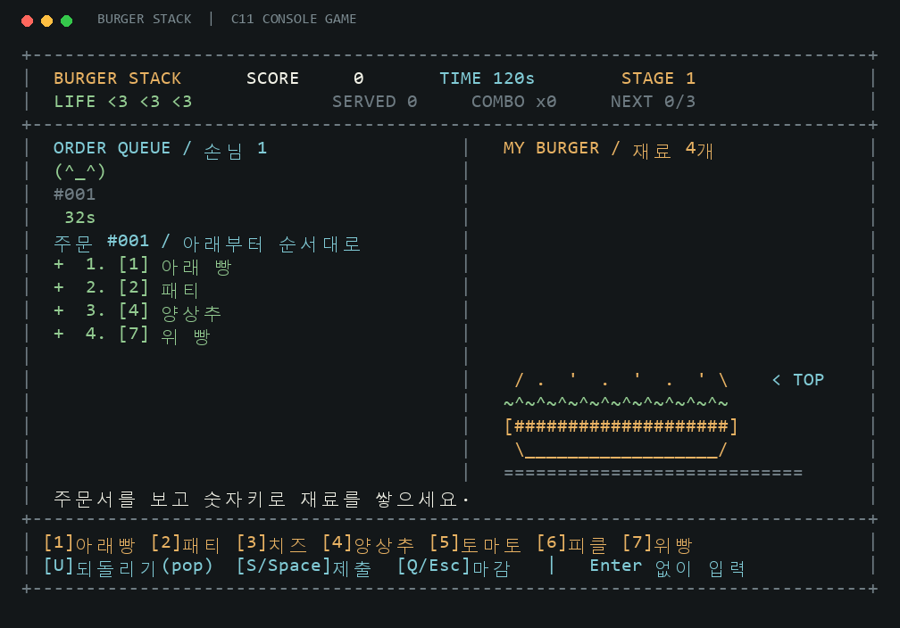

# BURGER STACK · 햄버거 만들기

주문서 순서대로 재료를 쌓아 손님에게 서빙하는 **C11 콘솔 게임**입니다. 자료구조 기말과제 제안 PPT의 스택·원형 큐·구조체 배열 정렬·파일 입출력을 구현했습니다. 게임 실행에는 외부 라이브러리가 필요하지 않습니다.



## 바로 실행

### Windows 10 / 11

컴파일러가 없으면 **[실행 파일 다운로드](https://github.com/YONGJI04/burger-stack-c/releases/latest)**에서 `burger-windows.zip`을 내려받아 압축을 풀고 **`play.bat`**을 실행하세요. 한글을 표시할 수 있는 Windows Terminal을 권장합니다.

소스에서 빌드하려면 GCC가 PATH에 있는 환경(MSYS2 MinGW64/UCRT64 등)에서 `build.bat`을 실행한 다음 `play.bat`을 실행합니다. PowerShell에서 직접 빌드할 수도 있습니다.

```powershell
gcc -std=c11 -Wall -Wextra -Wpedantic -Werror -O2 -Iinclude src/main.c src/game.c src/ranking.c src/terminal.c src/ui.c -o burger.exe -lm
.\burger.exe
```

### Linux / WSL / macOS

GCC 또는 Clang, `make`가 필요합니다.

```sh
git clone https://github.com/YONGJI04/burger-stack-c.git
cd burger-stack-c
make
./burger
```

macOS에서 GCC 명령이 없다면 `make CC=clang`을 사용합니다. VS Code에서는 **터미널 → 새 터미널**에서 실행하세요. 출력 패널·디버그 콘솔에는 실시간 키 입력이 전달되지 않습니다. `Ctrl+Shift+B`로 빌드할 수 있습니다.

화면 크기는 **80열 × 24행 이상**입니다. 창이 작아지면 안내를 표시하고 게임 및 손님 타이머를 함께 멈춥니다. 창을 다시 키우면 이어집니다.

## 조작법

| 키 | 동작 |
|---|---|
| `1` | 아래 빵 |
| `2` | 패티 |
| `3` | 치즈 |
| `4` | 양상추 |
| `5` | 토마토 |
| `6` | 피클 |
| `7` | 위 빵 |
| `U` | 맨 위 재료 하나 빼기 · pop |
| `S` / `Space` | 맨 앞 손님에게 제출 |
| `Q` / `Esc` | 영업 마감 → 점수 저장 화면 |
| `Ctrl+C` | 프로그램 종료 |

게임에서는 **Enter 없이** 반영됩니다. 대소문자 모두 가능하고, `Z`와 Backspace도 되돌리기로 사용할 수 있습니다. 메뉴는 숫자키 또는 방향키 + Enter로 선택합니다.

주문서의 **위에서 아래 순서**가 햄버거를 **아래부터 쌓는 순서**입니다. 예를 들어 아래 빵 → 패티 → 치즈 → 위 빵은 `1 2 3 7 S`로 제출합니다. 오른쪽 햄버거 그림은 실제 쌓인 모습이므로 가장 최근에 넣은 재료가 맨 위에 있습니다.

## 게임 규칙

- 기본 영업시간 120초, 목숨 3개로 시작합니다.
- 순서와 개수가 모두 맞으면 점수를 얻습니다. 오답 제출이나 손님 시간 초과는 목숨 -1입니다.
- 줄에 서 있는 **모든 손님**의 인내심이 입장 시점부터 줄어듭니다. 맨 앞 손님만 서빙할 수 있습니다.
- 표정은 `(^_^)` → `(-_-)` → `(>_<)`로 바뀌며 남은 초도 표시됩니다.
- 맨 앞 손님이 떠나면 만들던 햄버거를 비웁니다. 뒤 손님이 떠나면 현재 햄버거는 유지합니다.
- 3명 성공할 때마다 단계가 올라가며 최대 8단계입니다. 기존 손님의 주문과 마감시각은 유지되고, 새 손님부터 새 난이도가 적용됩니다.
- 시간 또는 목숨이 끝나면 결과 화면으로 이동합니다. 이름을 입력하고 Enter로 저장하거나 Esc로 저장을 생략합니다. 빈 이름은 `셰프`로 저장합니다.

| 단계 | 주문 재료 수 | 손님 인내심 | 대기열 목표 인원 | 입장 간격 |
|---|---:|---:|---:|---:|
| 1 | 4 | 32초 | 2 | 8초 |
| 2 | 5 | 29.5초 | 2 | 7.3초 |
| 3 | 5~6 | 27초 | 3 | 6.6초 |
| 4 | 6~7 | 24.5초 | 3 | 5.9초 |
| 5 | 6~7 | 22초 | 4 | 5.2초 |
| 6 | 7~8 | 19.5초 | 4 | 4.5초 |
| 7 | 7~8 | 17초 | 5 | 3.8초 |
| 8 | 8~9 | 14.5초 | 5 | 3.1초 |

대기열이 비면 다음 손님이 바로 옵니다. 주문은 아래 빵·패티로 시작하고 위 빵으로 끝납니다. 중간 재료는 중복될 수 있습니다.

점수는 `100 + 재료 수 × 10 + floor(손님 남은 초 / 2) × 5 + (min(연속 성공, 10) - 1) × 20`입니다. 실패하면 콤보가 초기화됩니다.

## 자료구조와 소스 구성

| 파일 | 역할 | 과제와의 연결 |
|---|---|---|
| `include/game.h`, `src/game.c` | 게임 상태·시간·주문 생성·채점 | 배열 스택 `push/pop`, 원형 큐 `enqueue/dequeue` |
| `src/ranking.c` | 전체 기록 읽기·정렬·추가 저장 | 구조체 동적 배열, `qsort`, 파일 입출력 |
| `src/terminal.c` | Enter 없는 키 입력·단조 시계·종료 복구 | Linux/macOS `termios/select`, Windows `_getwch` |
| `src/ui.c` | 한글 메뉴·손님 표정·햄버거 그림·랭킹 | 80×24 텍스트 화면, ANSI 색상 |
| `src/main.c` | 메뉴·플레이·이름 입력을 연결 | 게임의 전체 실행 흐름 |
| `tests/` | 자료구조·시간·파일·실제 터미널 검증 | 경계값과 랜덤 게임 테스트 |

스택은 `items[0]`이 바닥이고 `top`은 재료 개수입니다. 큐는 `front`가 첫 손님, `rear`가 다음 빈 칸이며, `(index + 1) % 5`로 순환합니다. 빈 큐와 가득 찬 큐는 `count`로 구분합니다. 채점은 스택과 주문서를 인덱스 0부터 비교합니다.

## 랭킹

실행한 디렉터리의 `ranking.txt`에 `점수<TAB>이름` 형식으로 모든 기록을 추가합니다. 읽을 때 전체를 점수 내림차순으로 정렬하고 상위 10개를 보여줍니다. 동점은 먼저 저장한 기록이 앞섭니다. 손상된 줄은 건너뛰고 개수를 표시합니다. 저장에 실패하면 결과 화면에 남아 재시도할 수 있습니다.

**랭킹은 각 컴퓨터에 따로 저장됩니다. 온라인 공동 랭킹은 아닙니다.** 개인 기록과 원본 PPT는 Git에 포함하지 않습니다.

## 실행 옵션

```sh
./burger --duration 60          # 60초 게임 (1~3600초)
./burger --seed 42              # 같은 주문으로 시작
./burger --ranking my-score.txt # 랭킹 경로 지정
./burger --no-color             # 색 없이 표시 (NO_COLOR도 지원)
./burger --demo                 # 예시 화면 출력 후 종료
./burger --help
```

## 검증과 10시간 루프

테스트 스크립트만 Python 3를 사용합니다. 게임 자체는 전부 C입니다.

```sh
make test        # C 단위·랜덤 테스트 + 실제 터미널 통합 테스트 (Linux/WSL/macOS)
make sanitize    # AddressSanitizer + UndefinedBehaviorSanitizer
make soak        # 10시간 자동 검증 (Linux/WSL/macOS)
```

루프는 기본 60초 간격으로 빌드를 확인하고, 매회 새로운 시드로 10,000개 게임을 시뮬레이션합니다. 처음 실행하거나 소스가 바뀌면 메모리 검사와 터미널 통합 테스트도 실행합니다. 실패하면 즉시 중단하여 실패 명령·시드를 남깁니다. **자동 코드 수정은 하지 않는 검증 루프**입니다.

- 상태: `logs/soak-status.json` (`running`, `completed`, `failed`, `stopped`)
- 상세 로그: `logs/soak.log`
- 중단: 실행 터미널에서 Ctrl+C, 백그라운드 실행이면 상태 파일의 PID에 `kill <PID>`
- PC가 종료되거나 WSL이 중단되면 루프도 중단됩니다. 이 경우 마지막 상태가 `running`이어도 PID가 살아 있는지 확인하세요.

```sh
python3 scripts/soak.py --hours 10 --interval 60 --rounds 10000
```

테스트가 끝났는지는 상태 파일의 실제 결과로 확인하세요. 실행을 시작했다는 사실과 10시간 검증 완료는 구분합니다.
